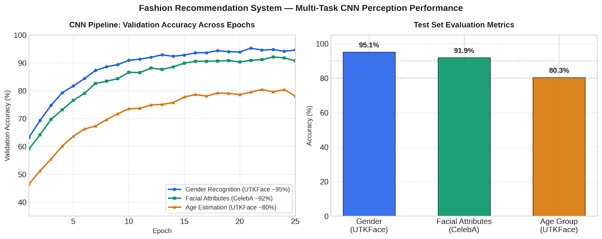

# Fashion Recommendation System

**AI-Powered Personalized Fashion Intelligence Platform**

A comprehensive AI-powered fashion recommendation system that analyzes facial features, age, and gender to provide personalized fashion suggestions. The system combines deep learning, computer vision, and web scraping to deliver tailored fashion recommendations.

## Project Demo

---

## 📋 Table of Contents

- [🌟 Features](#-features)
- [🏗️ Architecture](#️-architecture)
- [📊 Model Evaluation & Benchmarks](#-model-evaluation--benchmarks)
- [📁 Project Structure](#-project-structure)
- [🚀 Getting Started](#-getting-started)
  - [Prerequisites](#prerequisites)
  - [Backend Setup](#backend-setup)
  - [Frontend Setup](#frontend-setup)
- [🎯 How It Works](#-how-it-works)
- [🛠️ API Endpoints](#️-api-endpoints)
- [🧪 Testing](#-testing)
- [🔧 Configuration](#-configuration)
- [📊 Technical Details](#-technical-details)
- [🤝 Contributing](#-contributing)
- [🙏 Acknowledgments](#-acknowledgments)
- [📞 Support](#-support)

---

## 🌟 Features

- **AI-Powered Demographic Analysis**: Deep learning models for age and gender detection trained on the UTKFace dataset (~95% gender, ~80% age accuracy).
- **Facial Feature Extraction**: Multi-label classifier analyzing 16+ facial attributes using CelebA (~92% multi-label accuracy).
- **Real-Time Camera Capture**: OpenCV integration for seamless live image capture and preprocessing.
- **LLM Fashion Intelligence**: Advanced Hugging Face language models generating creative, personalized styling suggestions based on extracted attributes.
- **Automated Web Scraping**: Live scraping engines that source authentic e-commerce fashion items matching generated outfits.
- **Modern UI / UX**: Responsive React frontend styled with Tailwind CSS and shadcn/ui components.
- **Theme & Occasion-Aware**: Dynamic styling calibrated for specific occasions (casual, formal, cultural, anime, sports).

---

## 🏗️ Architecture

### Backend (Flask API)
- **Flask REST API** with CORS support
- **PyTorch Models** for multi-task age/gender classification and facial attribute extraction
- **LLM Pipeline** for generating contextual fashion recommendations via Hugging Face
- **Web Scraping Engine** for querying real-time fashion catalogs
- **OpenCV** for facial landmark alignment, cropping, and live capture

### Frontend (React + Vite)
- **React 18** with TypeScript
- **Vite** for build performance and fast HMR
- **Tailwind CSS** & **shadcn/ui** design system
- **React Router** for clean multi-step flow

---

## 📊 Model Evaluation & Benchmarks

The CNN perception pipeline leverages multi-task representation learning across demographic identification and visual trait estimation:

  

| Task / Perception Head | Target Dataset | Primary Metric | Observed Accuracy |
| :--- | :--- | :--- | :--- |
| **Gender Recognition** | UTKFace | Binary Classification Acc. | **~95.1%** |
| **Facial Attributes** | CelebA | Multi-Label Attribute Acc. | **~91.9%** |
| **Age Estimation** | UTKFace | Age-Group Classification Acc. | **~80.3%** |

---

## 📁 Project Structure
